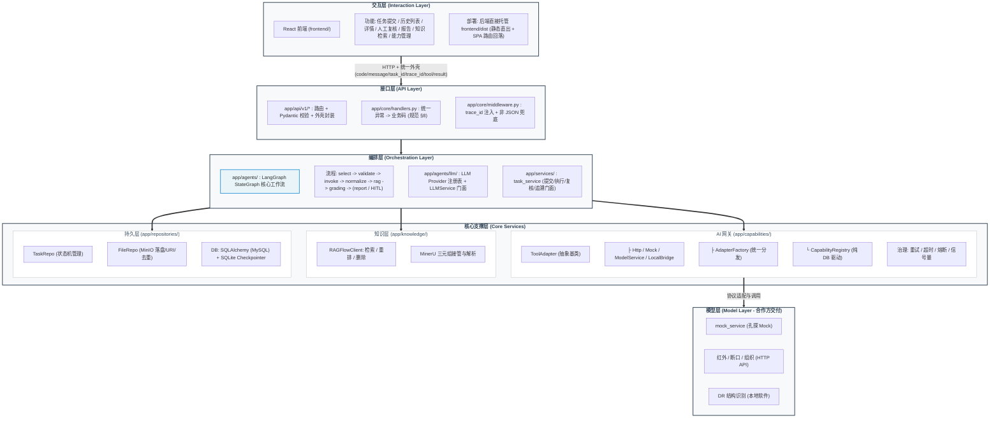

# 智能质检 Agent 系统

面向高端装备工业图像检测的智能质检 Agent 平台：统一调度算法模型、结果标准化、知识增强（RAG）、
规则判级、人工复核（HITL）与报告全链路留痕。

- 后端：FastAPI + LangGraph + Tool 注册中心（uv 管理，Python 3.11，对齐《公网云服务器验证环境准备》统一基线）
- 前端：React 18 + TypeScript + Vite + Ant Design（`frontend/`，后端直接托管构建产物）
- 统一接入：对齐《动力所工业图像智能算法工具统一API 接入规范 V1.0》（外壳/错误码/推理接口）
- 存储：MySQL（DDL 脚本化，utf8mb4）+ MinIO（内容寻址去重秒传，可降级本地落盘）
- LLM：langchain 抽象 + Provider 注册表（OpenAI 兼容协议，DashScope/Qwen，可选降级）
- Mock：本仓 `mock_service/`（合作方工具示例，按规范实现）

---

## 1. 系统架构



**分层铁律**：
- 接口层只做「路由 + 参数校验 + 外壳封装」，业务一律下沉 services；
- 节点不得直接访问 DB/文件（经 AgentContext 注入 registries/repos）；
- 图节点以 `state['error']` 收敛失败，不破坏图结构。

---

## 2. 核心工作流（LangGraph 状态图）

### 2.1 单场景质检（已实现，端到端验证）

```mermaid
flowchart TD
    %% 样式定义
    classDef defaultNode fill:#ffffff,stroke:#2c3e50,stroke-width:2px,color:#2c3e50;
    classDef startEnd fill:#e8f4f8,stroke:#3498db,stroke-width:2px,color:#2980b9,font-weight:bold;
    classDef condition fill:#fff9e6,stroke:#f39c12,stroke-width:2px,color:#d35400;
    classDef hitl fill:#fdeaea,stroke:#e74c3c,stroke-width:2px,stroke-dasharray: 5 5,color:#c0392b;

    %% 节点定义
    START((START)):::startEnd
    select[select_capability<br/>能力选择]:::defaultNode
    validate[validate<br/>输入校验]:::defaultNode
    invoke[invoke_capability<br/>调用模型]:::defaultNode
    normalize[normalize_result<br/>结果标准化]:::defaultNode
    rag[rag_retrieval<br/>知识检索]:::defaultNode
    grading{grading<br/>辅助判级}:::condition
    report_auto[generate_report<br/>生成报告]:::defaultNode
    report_manual[generate_report<br/>生成报告]:::defaultNode
    END_NODE((END)):::startEnd

    %% 主流程
    START --> select
    select -->|"capability 命中"| validate
    validate --> invoke
    invoke --> normalize
    normalize --> rag
    rag --> grading

    %% 判级分支
    grading -->|"level ∈ {pass, defect}"| report_auto
    grading -->|"level ∈ {review, fail}"| hitl_start

    %% 人工复核子图
    subgraph HITL [人工复核 Human-in-the-loop]
        direction TB
        hitl_start[human_review<br/>interrupt 暂停]:::hitl
        wait[等待前端提交<br/>POST /tasks/&#123;id&#125;/review]:::hitl
        resume[Command resume 恢复]:::hitl
        
        hitl_start -.->|挂起| wait
        wait -.->|携带复核数据| resume
    end

    resume --> report_manual

    %% 结束流程
    report_auto --> END_NODE
    report_manual --> END_NODE
```



| 节点 | 职责 | 依赖 | 失败策略 |
|------|------|------|---------|
| select_capability | 场景识别 + 能力路由一体（场景关键词 → 注册中心命中；规则未命中时 LLM 单候选采用、多候选仅记录） | registry | 场景缺失 → `__fail__` |
| validate | 校验必填输入（红外辐射 CSV、DR 参考图等 `input_required`） | manifest | `INVALID_REQUEST` |
| invoke_capability | 适配器调用（multipart + 统一外壳），标注图落盘 | adapter/file_repo | 网关错误码透传 |
| normalize_result | 分型标准化：缺陷（严重度枚举）/测量（单位）/分类（label/score）；产出 `grade_hint` | 纯函数 | `INFERENCE_FAILED` |
| rag_retrieval | 按 场景+缺陷类型+测量参数 检索 RAGFlow → 引用溯源 | ragflow | 无知识库 → 空引用（不阻塞） |
| grading | 规则引擎（YAML）：`max_severity`/`max_confidence`/结果族 → pass/defect/review/fail | rules | `INTERNAL_ERROR` |
| human_review | level=review → `interrupt()` 挂起（pass/defect/fail 自动放行）；接受 confirm/revise/requeue/reject | checkpointer | 复核意见入 state |
| generate_report | 聚合报告生成（Markdown，LLM 前导解读可选降级） | file_repo/LLM | 报告失败 → 错误态 |

> **HITL 语义（LangGraph 1.2+ 实测）**：节点内首调 `interrupt()` 抛 `GraphInterrupt` 暂停；
> 图外 `astream` 返回含 `__interrupt__` 键的事件；`Command(resume=...)` 恢复（节点重跑，
> interrupt 返回 resume 载荷）。详见 node_utils.py 注释与 tests/test_agent_interrupt.py。

### 2.2 多场景联合质检（规划，M2 起）

以单图为原子单元，`config/rules/joint.yaml`（待落地）声明调用顺序 + 下钻条件；
`task_service` 循环调度子图（上一场景输出作为下一级 auxiliary 输入），
各场景结果写入 state `joint_results` 后统一汇总部件级报告。

### 2.3 LangGraph Studio 可视化调试（看整个运行流程）

四张图经 `langgraph.json` → `app/studio.py`（独立装配，与主应用共用 .env/DB）
导出，`langgraph dev` 加载后在浏览器 Studio 里可视化：拓扑、任意输入运行、
逐节点状态、HITL interrupt/resume、time travel。

```bash
uv run langgraph dev        # 默认端口 2024；首次使用需登录免费 LangSmith 账号
```

启动后打开输出的 Studio UI 链接（smith.langchain.com/studio?baseUrl=...），
选图 → New Thread → 填输入 state → 运行，即可看到节点逐步点亮与状态演化。
图清单：`single`（固定流水线）/ `react`（ReAct 单场景）/ `joint`（联合父子链）/
`session`（会话智能体）。

注意：Studio 运行与 :8000 主服务相互独立但共用同一 DB，从 Studio 发起的运行
会写入真实任务记录；能力清单为装配期快照，能力表变更后重启 `langgraph dev`。

**react 图跑图片检测**：`input_uris` 填 JSON 数组，三种写法任选——
① 本地绝对路径（自动拷贝落盘）：`["/abs/path/to/img.jpg"]`；
② chat tab 直接上传图片随消息发送（自动从消息块提取落盘）；
③ 业务 URI（文件须在 `data/` 根内）：`["/api/v1/tasks/_studio/files/img.jpg?kind=inputs"]`。
仅支持 jpg/png。

**阻塞调用检测**：`langgraph dev` 内置阻塞调用检测（blockbuster），
图内同步文件 IO 已全部经 `asyncio.to_thread` 移出事件循环；若个别链路
（如第三方库内部）仍被拦截，可加 `--allow-blocking` 旁路（仅开发环境）。

**看主应用真实运行轨迹（互补方案）**：`.env` 里填 `LANGCHAIN_API_KEY`
（smith.langchain.com 免费申请）并把 `LANGCHAIN_TRACING_V2=true`，
主应用每次图运行（节点/LLM/工具调用）自动上报 trace，LangSmith 网页回看。

---

## LLM 增强点（工作流主干 + 受限 LLM 增强）

判级、能力选择、人工复核门仍由规则系统与注册表决定。LLM 仅参与：
1. 场景辅助识别（规则优先；多候选歧义且 `scene_confirm_enabled=true` 时暂停人工确认，默认 4004 收敛）
2. 检索 query 改写 + 有界多轮检索（`MAX_RETRIEVAL_ROUNDS=3`，首轮 top 分 >= 0.5 短路判定）
3. 指标解释（判级后，失败省略章节）
4. AI 综合分析引用校验（非法引用锚点被剔除）
5. 失败任务异常原因总结（error_report.md，无 LLM 时回退原始错误消息）

单任务 LLM 调用上界 ≈ 9 次，全部遵循「可用才调、失败降级」。

### 场景确认联调契约（前端）

详情页 `review` 载荷出现 `confirm_type == "scene"` 时的渲染与提交契约：

```json
// 待确认载荷（GET /api/v1/tasks/{id} 的 review 字段）
{
  "confirm_type": "scene",
  "task_id": "T...",
  "candidates": [{"scene": "borescope", "source": "llm"}, {"scene": "infrared", "source": "llm"}],
  "question": "检测场景存在歧义，请人工确认"
}
// 提交：POST /api/v1/tasks/{id}/scene-confirm  body: {"scene": "borescope", "opinion": "可选说明"}
```

---

## 3. 统一响应外壳与错误码

### 3.1 外壳（规范 §7）

```json
POST /api/v1/tasks   →   200
{"code":0,"message":"task submitted","task_id":"T...","trace_id":"trace-...",
 "tool":{"tool_name":"quality_inspection_agent","tool_version":"0.1.0","api_version":"v1"},
 "result":{"task_id":"T...","mode":"single"}}
```

错误亦必含 `result: null` 与业务码（`app/core/response.py::StandardEnvelope`）。

### 3.2 业务码（规范 §8 + 平台扩展，`app/core/errors.py`）

| 码 | HTTP | 语义 | 触发点 |
|----|------|------|--------|
| 0 | 200 | 成功 | - |
| 1001 | 400 | INVALID_REQUEST | 校验失败/缺文件 |
| 1002 | 415 | UNSUPPORTED_IMAGE_FORMAT | 上传非图像 |
| 1003 | 413 | IMAGE_TOO_LARGE | - |
| 1004 | 422 | INVALID_IMAGE | 空文件 |
| 2001 | 422 | INVALID_PARAMETER | parameters 非 JSON |
| 3001 | 503 | MODEL_NOT_READY | 工具 /health 503（CAPABILITY_NOT_READY 复用） |
| 3002 | 500 | INFERENCE_FAILED | 推理失败 |
| 3003 | 504 | INFERENCE_TIMEOUT | 超时 |
| 4001 | 500 | INTERNAL_ERROR | 未分类 |
| 4002 | 404 | TASK_NOT_FOUND | 任务不存在 |
| 4003 | 409 | TASK_STATE_CONFLICT | 非 awaiting_review 时复核 |
| 4004 | 404 | SCENARIO_NOT_SUPPORTED | 无能力路由 |
| 4005 | 503 | RAG_UNAVAILABLE | 知识库不可用 |
| 4006 | 503 | LLM_UNAVAILABLE | 大模型服务不可用 |
| 4007 | 502 | ADAPTER_ERROR | 网关适配错误 |

**网关透传**：工具返回 `code=x` 时，按 1001~4001 表映射为平台等价业务码（非机械透传）。

---

## 4. AI 网关与适配（app/capabilities，纯 DB 驱动）

```python
ToolAdapter(ABC): health() / invoke(ctx, image_paths, params, auxiliary) -> RawToolResponse
  ├─ HttpToolAdapter          # 规范 §5.2 multipart；错误检查 body.code（HTTP200 也可能是业务错）
  ├─ MockCapabilityAdapter    # mock_service 适配器（协议同 HttpToolAdapter，类型可识别）
  ├─ ModelServiceAdapter      # 模型服务（model_service）专用适配器
  └─ LocalSoftwareBridge      # M1 预研：in/ + manifest.json 投放，out/ 轮询回收

AdapterFactory（app/capabilities/factory.py）
  ├─ create(capability) -> ToolAdapter  # 按 CapabilityManifest.adapter_type 统一分发
  │   http -> HttpToolAdapter / mock -> MockCapabilityAdapter
  │   model_service -> ModelServiceAdapter / local_bridge -> LocalSoftwareBridge
  └─ 消除注册中心的 if/else 分发（registry.adapter_for 统一走工厂）

CapabilityRegistry（app/capabilities/registry.py，纯 DB 驱动）
  ├─ 事实源：capability_registry 表（建表 → sync_capabilities 种子 → 启动，B1 时序）
  ├─ lookup(scene)     # 场景路由（status=enabled 过滤，idx_scene_status 索引）
  ├─ 自动刷新：后台 15s 轮询 MAX(version) 比对，有变化全量重载 + 重建 Tool 装配
  ├─ reload(): POST /api/v1/capabilities/reload 立即生效（不等待轮询）
  ├─ adapter_for(capability_id)  # 适配器工厂 + 缓存（refresh 后整体重建）
  └─ status 启停控制：enabled/disabled/maintenance，DB 侧 UPDATE 即热生效
```

治理：有限重试（指数退避）、`GATEWAY_REQUEST_TIMEOUT_S` 超时、熔断器、并发信号量；
调用记录（tool/version/task_id/耗时/结果状态）随任务持久化满足「调用追踪」。

---

## 5. 知识层（app/knowledge/ragflow.py，内置实战坑位）

- **删除**：`DELETE /api/v1/datasets/{id}/documents` body `{"ids":[...]}` + 显式
  `Content-Type: application/json`；必须校验 body.code（HTTP 200 也可能业务错误）；
  异步收敛需轮询清单。
- **检索**：`top_k` 不可靠（传 5 可能回 30）→ 客户端截断；`image_id` 经平台代理前端展示。
- **MinerU**：`parser_config.layout_recognize` 必须 **PATCH 每个 document** 并写全三元组
  `mineru-from-env@mineru-from-env@MinerU`（dataset 级不回退）。
- **重排**：`/api/v1/rerank` 失败降级原序。
- **聊天助手**：启动时加载 `config/rules/ragflow_chat.yaml` 并调用 `POST /api/v1/chats`；
  同名助手已存在时精确复用并 `PATCH` 同步，避免重启或多 worker 产生重复资源。
- **会话与流式问答**：会话历史持久化在 RAGFlow；平台代理当前版
  `POST /api/v1/chat/completions` SSE，保留 `reference.chunks`、图片 ID、原文位置等完整引用。
  页面支持新建/切换/清空会话、停止生成和“删除原问答对后重发”。
- **运行中配置**：页面“助手配置”可校验并更新当前 chat，成功后原子回写 YAML 配置；
  服务端生成字段与密钥字段禁止写入项目配置。

---

## 6. LLM 层（app/agents/llm/）

- **Provider 注册表 + 工厂**（provider.py）：以 langchain `BaseChatModel` 为统一抽象，
  切换模型厂商 = 向 `PROVIDERS` 注册新 builder（内置 `openai_compatible`，
  DashScope/Qwen 等 OpenAI 兼容端点），LLMService 与调用点零改动；
- **LLMService 门面**（service.py）：langchain ainvoke + system 提示词挂载 + vlm 路由；
- **提示词**（prompts.py + `config/prompt_template/system_prompt.yaml`）：模板外置，
  占位符兼容 jinja2 表达式；
- **降级**：LLM 不可用（4006）不阻塞主链路，报告生成降级为纯模板。

---

## 7. 目录结构

```
QualityCheckingAgent/
├── pyproject.toml / uv.lock / .env.example
├── app/
│   ├── main.py                  # create_app + lifespan(AppContainer) + 前端 dist 托管（SPA 回落）
│   ├── api/
│   │   ├── v1/                  # 平铺路由：health / capability / task / report
│   │   │                        # 分层铁律：路由层只做路由+校验+外壳，业务下沉 services
│   │   └── schemas/             # task / capability（Pydantic）
│   ├── agents/                  # 编排层（LangGraph 状态图）+ Tool 注册中心 + LLM 层
│   │   ├── state.py             # AgentState（TypedDict）
│   │   ├── graph.py             # StateGraph 装配 + review Command 构造
│   │   ├── nodes/               # select_capability / validate / invoke_capability /
│   │   │                        #   normalize_result / rag_retrieval / grading /
│   │   │                        #   human_review / generate_report + node_utils
│   │   │                        #   ※ infer/rag 从 ToolRegistry 取工具（无硬编码）
│   │   ├── routers/scene_router.py  # 场景路由（独立可测）
│   │   ├── llm/                 # provider（注册表+工厂）/ service（LLMService 门面）/ prompts
│   │   └── tools/               # ── Tool 注册中心（对齐成熟 Agent 框架模式）──
│   │       ├── registry.py      # Tool 抽象 + ToolRegistry + 进程级默认注册表
│   │       ├── assemble.py      # 容器装配：DB manifest 动态挂载为工具
│   │       ├── infer_tool.py    # 算法检测工具（按 capability_id 动态解析最新 manifest）
│   │       └── rag_tool.py      # 知识检索工具
│   ├── capabilities/            # 能力注册中心（纯 DB 驱动）
│   │   ├── registry.py          # 内存缓存 + 15s version 轮询 + reload + 场景路由
│   │   ├── factory.py           # AdapterFactory：按 adapter_type 统一分发
│   │   ├── adapters/            # base / http_adapter / mock_adapter /
│   │   │                        #   model_service_adapter / local_bridge_adapter
│   │   └── normalizers/         # defect/measurement/classification 分型标准化
│   ├── knowledge/ragflow.py     # RAGFlowClient（检索/解析/删除）
│   ├── models/                  # task / capability / report（领域模型）
│   ├── repositories/            # db / task_repo / file_repo / object_repo / capability_repo
│   ├── services/                # task_service / capability_service / report_service /
│   │                            #   container / deps(AgentContext)
│   │   └── storage/minio_service.py  # MinIO 内容寻址去重（秒传）
│   └── core/                    # config / errors / response / logger(合并) /
│                                #   handlers / middleware / context
├── frontend/                    # React 18 + TS + Vite + Ant Design（见 frontend/README.md）
│   ├── src/                     # api（外壳解包+trace_id 透传）/ pages / components / types
│   └── dist/                    # 构建产物，后端直接托管（静态直出 + SPA 路由回落）
├── config/
│   ├── rules/grade_rules.yaml   # 判级规则（业务专家固化）
│   └── prompt_template/system_prompt.yaml  # LLM 提示词模板
├── scripts/
│   ├── sql/init.sql             # MySQL DDL（utf8mb4 + 全字段 COMMENT，唯一权威）
│   └── sync_capabilities.py     # 能力注册种子脚本（BUILTIN_CAPABILITIES 映射 + mock 身份）
├── mock_service/                # 合作方算法工具 Mock（统一规范实现，自报身份）
├── docs/                        # 需求评估 / 统一接入规范 / 硬件配置评估 / 文献
└── tests/                       # pytest（目录镜像 app/ 分层）
    ├── conftest.py              # 根级：路径 + 共享 SQLite DB fixture
    ├── api/v1/                  # test_handlers / test_report / test_frontend_static
    ├── core/                    # 统一外壳（test_response.py）
    ├── agents/                  # test_agent_interrupt / test_graph_routing / test_scene_router /
    │                            #   test_llm_prompts / test_llm_provider / test_llm_service /
    │                            #   tools/test_registry
    ├── capabilities/            # test_capability_repo / test_capability_registry /
    │                            #   test_adapter_factory / test_http_adapter / test_normalizers
    ├── services/                # Storage 去重（test_storage.py）
    └── repositories/            # test_task_repo / test_file_repo
```

---

## 8. 快速开始（开发环境）

```bash
# 1. 依赖（uv 强制）
uv sync

# 2. 启动算法 Mock（单进程六场景域：borescope / infrared / dr / fpi / fracture / metallography，统一 8002）
uv run uvicorn mock_service.main:app --port 8002 &

# 3. 数据库初始化（平台运行库＝MySQL；权威 DDL 建库 + 建表）
#    mysql -u root -p < scripts/sql/init.sql   # 建库(utf8mb4) + capability_registry/tasks/file_objects/knowledge_docs
#    开发期需本地 MySQL：.env 里 DATABASE_URL=mysql+aiomysql://<user>:<pass>@127.0.0.1:3306/quality_inspection
#    单元测试同样跑 MySQL（独立 schema qc_test，session 起始重建，见 tests/db_base.py）

# 4. 能力注册（纯 DB 驱动，B1 运维时序：建表 → 种子 → 启动；幂等可重复执行）
uv run python -m scripts.sync_capabilities   # 注册六个场景能力入 capability_registry

# 5. 可选：MinIO（配置 MINIO_* 即启用内容寻址去重；留空自动降级本地落盘）
#    export MINIO_ENDPOINT=localhost:9000 MINIO_ACCESS_KEY=minioadmin MINIO_SECRET_KEY=minioadmin

# 6. 可选：LLM（OpenAI 兼容协议；留空则报告解读降级为纯模板）
#    DASHSCOPE_API_KEY / LLM_MODEL / VLM_MODEL / LLM_BASE_URL（见 .env.example）

# 7. 启动平台
CHECKPOINTER_PATH=./data/state.db \
uv run uvicorn app.main:app --port 8000
# API 文档：http://localhost:8000/docs ；前端页面：http://localhost:8000/（托管 frontend/dist）
# CHECKPOINTER_PATH 仍是 SQLite：那是 LangGraph 人工复核断点库（R3 保留项），与任务/能力库无关
```

### 前端

```bash
cd frontend
npm install
npm run build        # 构建 dist/ 供后端托管（另有 build:watch 自动重建）
npm run dev          # 开发模式：Vite dev server + /api 代理到 http://localhost:8000
npm test             # vitest 单元测试
```

> **图结构变更后清断点库**：编排层结构升级会作废旧 checkpointer 断点（开发期数据）。
> 升级后启动前先删旧断点库（**只删 state.db；任务与能力数据在 MySQL，不在本地文件**）：
> ```bash
> rm -f data/state.db   # 旧断点作废；应用启动时自动重建空断点库
> ```

**能力注册中心（纯 DB 驱动）**：事实源为 `capability_registry` 表，运行时不读任何文件；
新装环境按「建表 → sync_capabilities 种子 → 启动」顺序执行（B1），空表启动不崩溃，
健康巡检标红 `no capability configured`（任务路由 4004）；启停控制
`UPDATE capability_registry SET status='disabled'|'maintenance' WHERE capability_id=...`，
15s 轮询自动生效，`POST /api/v1/capabilities/reload` 立即生效。

**数据库规范**：DDL/DML 唯一出处 `scripts/sql/`，代码零建表语句
（`init_db` 只执行脚本）；MySQL 表/字段全部 `COMMENT` + `utf8mb4_general_ci`。

**对象存储（内容寻址去重）**：`StorageService.store_bytes` 分块读算 SHA-256 →
查 `file_objects`（Hash 主键）→ 命中秒传（仅引用计数+1）/ 未命中上传 `{sha256}.{ext}`
落库。相同文件无论重复上传多少次只存一份。

**注意**：宿主环境（OrbStack 等容器运行时）可能劫持 `localhost` 的解析，
网关已内置 `localhost → 127.0.0.1` 容错（app/capabilities/adapters/http_adapter.py）。

---

## 9. 冒烟链路（对应 docs/image 样例）

```bash
# 提交 abnormal 任务（mock_severity=high 命中 max_severity>=3 规则 → 人工复核门；
# 复核门只在规则命中时触发：低置信度检测结果（max_confidence<0.5）/高严重度/分类族，
# 其余自动判级放行）
curl -X POST http://127.0.0.1:8000/api/v1/tasks \
  -F "files=@docs/image/class1_1.jpg" \
  -F "scene=borescope" \
  -F 'parameters={"mock_status":"abnormal","mock_severity":"high","confidence_threshold":0.5,"max_defects":3,"return_annotated":true}'
# → {"task_id": "T..."}

# 状态（awaiting_review 时携带复核问题）
curl http://127.0.0.1:8000/api/v1/tasks/{task_id}

# 人工复核（恢复执行 → 生成报告）
curl -X POST http://127.0.0.1:8000/api/v1/tasks/{task_id}/review \
  -H 'Content-Type: application/json' \
  -d '{"action":"confirm","opinion":"专家确认，放行"}'

# 下载报告
curl http://127.0.0.1:8000/api/v1/tasks/{task_id}/files/report.md?kind=reports
```

## 10. API 一览

| 方法 | 路径 | 说明 |
|------|------|------|
| GET | /health | 平台健康（DB 探测） |
| GET | /api/v1/capabilities | 能力注册中心（model_manifest，分页外壳） |
| GET | /api/v1/capabilities/health | 各工具健康巡检 |
| POST | /api/v1/capabilities/reload | 热更新 manifest |
| POST | /api/v1/tasks | 提交任务（multipart 图像 + 参数） |
| GET | /api/v1/tasks | 任务历史列表（分页 + 场景/状态筛选） |
| GET | /api/v1/tasks/{id} | 任务详情（步骤/结果/判级/复核/报告） |
| POST | /api/v1/tasks/{id}/review | 人工复核恢复（confirm/revise/requeue/reject） |
| GET | /api/v1/tasks/{id}/files/{name}?kind= | 原图/标注图/报告下载 |
| GET | /api/v1/reports/{task_id} | 报告内容查询（meta + 正文） |
| GET | /* | 前端 SPA（frontend/dist 静态直出，无扩展名路径回落 index.html） |

---

## 11. 里程碑落地（M1–M4 对照）

| 里程碑 | 已完成 | 待落地 |
|--------|--------------|--------|
| M1 | 脚手架 + 统一外壳/错误码 + 能力注册中心 + HTTP 适配器 + mock 链路（提交→推理→标准化→判级→报告） | 其余 HTTP 模型 manifest 补齐；本地软件桥接技术预研 |
| M2 | 编排层（单场景+HITL 复核）+ Tool 注册中心（manifest 动态挂载）+ MinIO 内容寻址去重 + MySQL DDL 脚本化 + React 前端（后端托管 dist + SPA 路由 + vitest）+ LLM 层（langchain Provider 抽象 + 提示词模板化） | 模型文件容器化封装；多场景联合质检流程（joint.yaml）；知识增强全链路（RAGFlow 联调 + MinerU 解析批量入库） |
| M3 | 能力注册中心纯 DB 驱动化（capability_registry 表 + 15s 轮询热生效 + 三态启停 + sync_capabilities 种子 + normalizers 拆分） | 已到位模型接入（红外/断口/组织）；判级规则与严重度映射客户确认；外部环境联调 |
| M4 | - | 内网部署迁移（DATABASE_URL 切 MySQL 执行 init.sql、MinIO 落地、CORS/全局日志）；权限/观测/留痕完善；试运行验收 |

## 12. 测试

```bash
uv run pytest tests/ -q             # 后端用例，目录镜像 app/ 分层
cd frontend && npm test             # 前端 vitest 单元测试
cd frontend && npm run test:e2e     # Playwright E2E（前置：:8000 后端 + :8002 mock 推理在跑）
```

E2E（`frontend/e2e/`，11 例）打真实开发环境，全部自建任务、只断言自建对象：
提交/列表/详情/工作台/报告页走「API 建数 + UI 操作」，对话内终裁复核卡走
「API 建会话 + DB 注入 task_card 归属消息 + 落定回注」确定性链路（不依赖
LLM/VLM）；chromium 单浏览器串行，失败自动留 trace/截图与 HTML 报告。

## 13. 相关文档

- 数据库 DDL：[scripts/sql/init.sql](scripts/sql/init.sql)（MySQL 权威版，平台唯一运行库；单元测试基座同源，见 `tests/db_base.py`）
- 需求评估：docs/原始材料/智能质检Agent系统_需求评估文档.md
- 接入规范：docs/（公开）动力所工业图像智能算法工具统一API接入规范_V1.0.md
- 验证环境：docs/公网云服务器验证环境准备.md（环境要求/目录端口/账户/验收项）
- 服务器部署：[deploy/README.md](deploy/README.md)（平台非容器化 runbook：systemd、复用 RAGFlow MySQL/MinIO、备份制度）
  + [deploy/env-prep/README.md](deploy/env-prep/README.md)（验证环境准备脚本：Python 3.11 编译、目录/账户/端口、基线采集、验收自检）
- 前端说明：frontend/README.md

## 14. 新增算法工具（对合作方模型，能力注册中心纯 DB 驱动）

1. 在 `scripts/sync_capabilities.py` 的 `BUILTIN_CAPABILITIES` 映射表中登记新工具
   （capability_id/scene/capability_type/adapter_type/endpoint/默认参数；tool_name 须与
   mock 自报身份一致）；
2. 执行 `uv run python -m scripts.sync_capabilities` 幂等 upsert 入 `capability_registry` 表；
3. 平台 15s 轮询自动装配为 `detect/<tool_name>` Tool（或 `POST /api/v1/capabilities/reload`
   立即生效），infer 节点零改动；
4. 启停控制：`UPDATE capability_registry SET status='disabled'|'maintenance' WHERE capability_id=...`
   ——生效后路由自动绕行（4004）但能力记录保留；
5. 判级规则在 `config/rules/grade_rules.yaml` 按业务专家口径固化。

---

## 15. Harness Workflow 编排（DeepSeek Harness + @dsh-external/workflow）

**定位**：harness 原生质检平台形态——不依赖 :8000 FastAPI 平台进程，唯一服务依赖为 mock 工具层 :8002（单进程六缺陷域，统一 API 规范）。任务编排、结果标准化、规则判级、HITL 人工复核、知识增强、综合研判与报告生成全部由 DSH workflow capsule + 子 Agent 承担。

### 15.1 架构映射（平台职能 → Workflow 实现）

| 平台（:8000）职能 | Harness Workflow 实现 |
|---|---|
| 意图解析 / 任务提交 | intake：intake-analyst 子 Agent 解析需求 → mode/images/scenes/autoReview |
| 能力注册 / 健康巡检 | dispatch：tool-dispatch 子 Agent `GET :8002/health` 核对 defect_domains |
| 推理调用 + 结果标准化 | inspect：inspect-N 子 Agent 直调 `POST /api/v1/inference`（multipart 统一外壳），结构化输出转写即标准化 |
| 规则判级（grade_rules.yaml） | grade：**源码纯 JS 确定性判级**（severity high=3/medium=2/low=1；`max_severity>=3` 或 `max_confidence<0.5` 或 `family==classification` → review），无 LLM |
| HITL 人工复核 | review：reviewer-N 子 Agent + 两段式父级中介（见 15.4） |
| 知识增强（RAGFlow 替代） | knowledge：knowledge-retrieval 子 Agent 检索本地 docs/*.md + PDF（pdftotext），不可达优雅降级 available=false |
| 综合研判 | synthesize：wf.synthesize 强制三层区分（工具原始/系统汇总/人工复核） |
| 报告生成 | report：report-writer 子 Agent 汇编 Markdown + curl 下载标注图归档 |
| 全链路留痕 | `data/workflow-tasks/<task_id>.json`（+.review.json）+ run 目录（events/results/artifacts）+ qc-evidence artifact |

### 15.2 文件布局

- `scripts/workflows/qc-inspection.source.js` — 受限源码（唯一事实源，修改后必须重建）
- `scripts/workflows/build_capsule.py` — capsule 构建器（manifest + source → capsule JSON）
- `scripts/workflows/run-config.json` — 可选文件化参数（不存在 = 源码内置默认值）
- `.dsh/workflows/qc-inspection.workflow.json` — 项目级 capsule（8 阶段：intake→dispatch→inspect→grade→review→knowledge→synthesize→report）
- `data/workflow-tasks/`、`data/workflow-reports/`（+`artifacts/`）— 任务留痕与报告输出
- `.dsh/workflow-runs/<runId>/` — 引擎 run 目录（run.json / events.jsonl / results / artifacts）
- `scripts/workflows/review_bridge.py` — 复核桥接服务（FastAPI :8010：队列 API + 原图/标注图托管 + 页面托管 + run 状态 API，见 15.8）
- `data/review-queue/pending|decisions/` — 复核文件队列（reviewer 登记待复核记录 / 用户决定原子落盘）
- `Qwen_html_20260908_mhf78k7na.html` — 前端复核页（已改造：人工复核工作台 + 任务编排 stepper/最近任务接真实 run 数据，经桥接服务托管访问）
- `scripts/workflows/sync_to_db.py` → `data/qc.db` — SQLite 全量入库（runs/tasks/defects/reviews/reports/run_events/file_artifacts BLOB，幂等 UPSERT，零第三方依赖）

### 15.3 快速开始

```bash
# 1) 启动 mock 工具层（单进程六场景域）
.venv/bin/uvicorn mock_service.main:app --port 8002 &

# 2)（重新）构建 capsule —— 修改 source 后必须执行
python3 scripts/workflows/build_capsule.py
```

在 DSH 会话中运行（两种方式）：

- 斜杠命令（args 正确解析 JSON）：`/workflow qc-inspection {"mode":"batch","images":["docs/image/class1_1.jpg"]}`
- 自然语言让主 Agent 按名调用：`run_workflow(name="qc-inspection")`

**参数三层合并**（优先级从高到低）：显式 args ＞ `scripts/workflows/run-config.json` ＞ 源码内置 DEFAULTS。已知参数键：`requirement` / `images[]` / `scenes[]` / `mode`(single|batch|joint) / `mockStatus`(normal|abnormal) / `mockSeverity`(random|low|medium|high；mock 原生联调参数，非 random 时确定性强制全部缺陷严重度——`{"mockSeverity":"high"}` 可复现触发复核门，随机演示保持 `random`) / `autoReview`。

> ⚠️ 主 Agent 经 tool relay 调用 run_workflow 时 args 对象会被字符串化（relay 缺陷），capsule inputSchema 因此全部可选——文件化参数优先用 run-config.json 或斜杠命令。

三种模式 run-config.json 示例：

```json
// batch：多图 × 多场景轮转，无人值守
{"mode":"batch","images":["docs/image/class1_1.jpg","docs/image/class2_1.jpg"],"scenes":["borescope","fracture","metallography","fpi"],"autoReview":true,"mockStatus":"abnormal"}

// joint：同一图像多场景并联
{"mode":"joint","images":["docs/image/class1_1.jpg"],"scenes":["borescope","fracture"],"autoReview":true,"mockStatus":"abnormal"}
```

### 15.4 人工复核 HITL：前端复核页模式 + 聊天转呈兜底（关键设计）

DSH 运行时禁止子 Agent 直接与人交互（"human interaction is unavailable while the calling agent is owned by another live agent"）。复核门闭环有两种形态：

**形态 A（默认）：前端复核页 · run 内原生闭环**（2026-09-09 实证 run-12395c56，组件与时间线见 15.8）

1. run 内判级命中 review → reviewer 子 Agent 将源码预构建的确定性 JSON 登记至 `data/review-queue/pending/<task_id>.json`，并下载标注图供页面展示；
2. 用户在前端复核页（`review_bridge.py` 托管于 http://127.0.0.1:8010/）看到卡片：原图+标注图并排、缺陷明细表、判级依据横幅、四个终判按钮（confirm/revise/reject/requeue）+ 意见框；
3. 提交 → 桥接服务原子写入 `data/review-queue/decisions/<task_id>.json`；
4. reviewer 有界轮询读到决定（30 轮 × ~50s ≈ 31 分钟窗口，每轮单次 bash ≤55s 规避 60s 工具超时）→ **run 内**写 `.review.json`（reviewed_by 标记前端来源）→ run 原生续跑知识检索→综合研判→报告，全程无聊天弹窗、无事后补录。

**形态 B（兜底）：两段式父级中介转呈**

5. 轮询超时未获决定 → reviewer 不代替用户决定，输出 `need_human=true`；run 以 `pending_human_review` 计数正常完成（终判悬置，报告如实标注）；
6. 顶级 Agent 从 run 结果转呈给用户（GUI 弹窗），用户裁决 confirm / revise / reject / requeue；
7. 顶级 Agent 回填 `<task_id>.review.json` 并更新报告终判章节；**迟到的页面决定同样有效**——决定文件落盘后按同一方式补录（实证 run-6e3db2dd：页面前端决定 09:27 落盘 → 顶级 Agent 补录 review.json + 报告第四节改写 + DB 入库，业务状态叠加视图 final=defect）。

`autoReview=true` 时 reviewer 自动 confirm（批量筛查无人值守，不写队列）。形态 A 实证：run-12395c56 页面决定 09:49:07 → reviewer 09:49:31 读到（24s）→ run 内亲笔留痕 → review phase 09:49:54 完成原生续跑。

### 15.5 治理操作（2026-09-08 实测语义）

| 操作 | 命令（workflow_manage） | 实测语义 |
|---|---|---|
| 列表 | `action=runs` | 全部 run（状态/spawned/artifacts） |
| 详情 | `action=show target=<runId>` | run.json 快照 |
| 暂停/恢复 | `action=pause` / `resume` | **协作式**：阻止新 agent spawn；在途 agent 跑完；源码纯逻辑阶段继续推进；resume 解除阻塞 |
| 停止 | `action=stop` | 级联截停：在途 agent cancelled、后续 spawn 即停，终态 stopped；job 通知 killed |
| 重跑 | `action=rerun target=<runId>` | 用存储 capsule + 原 args 发起**新 run**（文件化参数重新读取 run-config.json） |
| 断点续跑 | `action=resume-run target=<runId>` | 发起新 run；**v0.1.2 效果重放不生效**（replayEffects 读 `snapshot.result.results`，而按-agent 结果持久化在 `outcome.results`；stopped run 的 result 为 null）→ 实测 replayedAgents=0，等同 rerun |
| 删除 | `action=delete-run target=<runId> [force=true]` | 非 force 仅删终态；force 清僵尸。**hub 重启会从磁盘恢复已删记录**（重启前的删除可能复活，需重删） |
| 修剪 | `action=prune keep=N [older_than_days=D] [dry_run=true]` | 仅终态 run；保留最新 N 个；dry_run 预览 candidates；执行即 rmSync 整个 run 目录 |
| 并发 | — | 多 run 可并行（batch+joint 并行实证）。run 启动后长时间静止（events 停在 workflow-started、run.json updatedAt 冻结）＝ **DSH workflow 审批门等待**：engine.js 在 workflow-started 后 `await approval.request`，需 GUI 弹窗批准（macOS 有 attention-chime 通知）。此前实测的 3.3/2.9 分钟"准入延迟"实为审批点击等待——僵尸记录占名额系错误归因，2026-09-09 经源码级证据修正 |

### 15.6 已知限制与兼容性注意

1. **插件版本漂移**：@dsh-external/workflow v0.1.2 声明兼容 DSH 0.0.1-rc.2，实际宿主 0.1.2-rc.1 不再在内存暴露 `localAgent.session.events` → 子 Agent 收集时抛 "agent.session.events is not iterable"。已本地补丁 `engine.js` 5 处（`agent.session?.events ?? []`，备份 `engine.js.orig-0.1.2`），需 Plugin Hub 重启生效；上游（github.com/icetomoyo/dsh_workflow@44b83c1）暂无修复。
2. **outputSchema 宿主子集**：仅 `type ∈ object/array/string/number/integer/boolean/null` + oneOf/enum/const/items/properties/required/additionalProperties(boolean)；**无 `json` 类型**（bbox 用 `oneOf:[array<number>,null]`）。校验器：`@deepseek-ai/dsh-tools` assertObjectJsonSchema（可离线预校验）。
3. token 统计在该 DSH 构建显示 0（补丁后 usage 不可得）——仅展示影响。
4. mock 标注图为内存存储：:8002 重启后历史 artifact URI 404（报告下载时标注并跳过）。
5. resume-run 效果重放不生效（见 15.5）。
6. 本编排为开发侧演示/预演形态：单用户会话驱动；workflow 支持多 run 并发但**无多租户隔离**，多用户并发生产服务仍需 :8000 平台形态或独立服务。
7. **workflow 审批门（2026-09-09 源码级+实证）**：插件 approvalMode 默认 `generated-and-local` → capability-generated 胶囊每次启动经 engine.js `await approval.request`；`startNamed`（run_workflow name= 与 /workflow relay 均走此路）不传 approvalGranted，仅**内联 source** 路径的显式意图交接可免弹窗（index.js explicitIntent）。审批等待无超时：run-6e3db2dd 静止约 9.4 小时（前夜 23:42 启动、次日 09:04 GUI 批准），批准后 20 秒内 intake 即启动。

### 15.7 验证记录（2026-09-08）

- **P2 单任务** run-8e7e0d43：8 阶段全通过；review 触发（晶粒粗大 high/0.643，max_severity>=3）；两段式 HITL 用户 confirm → defect 回填；报告+标注图+复核留痕齐全。
- **P3 批量** run-c2755527：8 图 × 4 场景轮转；5 review 自动 confirm + 3 直接 defect；汇总 19 处缺陷（high×7/medium×5/low×7）；8 张标注图归档。
- **P3 联合** run-4f450c61：同图 borescope+fracture 并联；双场景各自缺陷集；三层综合研判。
- **P4 治理** run-de00524e（rerun→pause→resume→stop 全序列）+ run-fa19ddd4（resume-run 全新重跑）+ delete-run×2 僵尸 + prune 清理。
- 干跑预检：全部 outputSchema 经宿主校验器 + 数值双验证（bbox 数组/null 双分支）。

### 15.8 前端复核页 HITL 模式（2026-09-09 实证）

**问题**：两段式父级中介 HITL 依赖聊天弹窗转呈；真实业务要求用户在独立前端页面上完成复核终判。
**方案**：文件队列 + 桥接服务 + 页面轮询三件套，reviewer 子 Agent 在 run 内有界等待页面决定——

| 组件 | 位置 | 职责 |
|---|---|---|
| 待复核队列 | `data/review-queue/pending/<task_id>.json` | reviewer 登记（JSON 由 capsule 源码预构建，确定性非 LLM 手写：缺陷明细/判级依据/图片 URL/四选项语义） |
| 决定队列 | `data/review-queue/decisions/<task_id>.json` | 桥接服务原子写入（tmp+os.replace），字段 action/opinion/reviewer/decided_at |
| 桥接服务 | `scripts/workflows/review_bridge.py` → http://127.0.0.1:8010/ | FastAPI：`/api/reviews/pending|decided|{id}|{id}/decision` + `/api/runs|runs/latest` + 原图/标注图托管 + 页面托管；仅监听 127.0.0.1，路径 basename 防穿越，重复提交 409 |
| 前端页面 | `Qwen_html_20260908_mhf78k7na.html`（改造，保留原设计） | 人工复核工作台（4s 轮询：待审卡片/原图+标注图并排/缺陷表/判级横幅/四终判按钮+意见框/已决定列表）+ 任务编排 stepper 接真实 8 阶段 + 最近任务接真实 runs |

**启动**：`.venv/bin/python scripts/workflows/review_bridge.py`（宜作后台受管 job），浏览器开 http://127.0.0.1:8010/ 。

**可复现触发复核门**：`scripts/workflows/run-config.json` 写 `{"mockSeverity":"high"}`（mock :8002 原生联调参数，源码注释即写明"平台判级/复核门演示需要可复现"；确定性强制全部缺陷 high → max_severity>=3 必命中 review）。删除该配置恢复随机缺陷（约 30% 概率不触发复核门 = 零打扰全自动通道）。

**时间线实证（run-12395c56，形态 A：run 内原生闭环，本地时刻）**：

| 时刻 | 事件 |
|---|---|
| 09:45:47 | run 启动（同日审批记忆命中，3 秒进 intake） |
| 09:46:11 | intake 完成：run-config `mockSeverity=high` 并入 cfg |
| 09:48:26 | inspect+grade 完成：crack high/0.636 → 命中 max_severity>=3 → review，reviewer-1 启动 |
| 09:49:03 | reviewer 登记待复核记录 + 下载标注图 → **页面卡片上线** |
| 09:49:07 | **用户在页面提交 confirm** → 桥接原子写决定文件 |
| 09:49:31 | **reviewer 首轮轮询读到（决定后 24s），run 内亲笔写 `.review.json`**（reviewed_by=于小标（前端复核页）-via-review-bridge） |
| 09:49:54 | review phase 完成，run **原生续跑**（knowledge→synthesize→report），无聊天弹窗、无事后补录 |
| 09:54:02 | run 完成：`review_action=confirm, final=defect, pending_human_review=0`；报告第四节原生含复核人/动作/终判/轮次；综合研判摘要明书"复核人于小标经前端复核页第 1 轮即作出 confirm 决定" |

**双形态对照实证（同日）**：
- 形态 B 兜底 + 迟到补录（run-6e3db2dd）：当时窗口仅 10 轮，reviewer 有界轮询 10m22s 无决定 → 不代替用户决定，need_human=true → run 以 pending_human_review=1 完成、报告如实标注"终判未出"；用户随后（09:27）在页面提交 → 决定文件照常落盘 → 顶级 Agent 依文件补录 review.json + 报告第四节改写 + DB 入库，业务状态叠加视图 final=defect。**页面决定晚于窗口仍然有效。**
- 零打扰通道（run-66da9942）：随机缺陷全 low（max_severity<3 且 min_confidence 0.669>0.5）→ 复核门未触发：reviewer 不 spawn、页面无卡片、review_action=null、pending_human_review=0，全程自动完成。

**DB 终态（sync_to_db 后）**：8 runs / 18 tasks / 40 defects / 12 reviews / 7 reports / 328 run_events / 23 BLOB（22.6MB）；前端决定行 `reviewed_by=于小标（前端复核页）-via-review-bridge` 可 SQL 直查。

**已知边界**：页面决定窗口 = reviewer 轮询窗口（现 30 轮 × ~50s ≈ 31 分钟，引擎 wall 上限 1 小时内安全）；窗口内决定 → 报告原生生成，迟到决定 → 兜底补录（留痕等价，仅报告生成方式不同）。桥接服务无鉴权（127.0.0.1 单机演示定位）；生产化需加认证、把文件队列换 DB/MQ、页面走正式前端工程。
